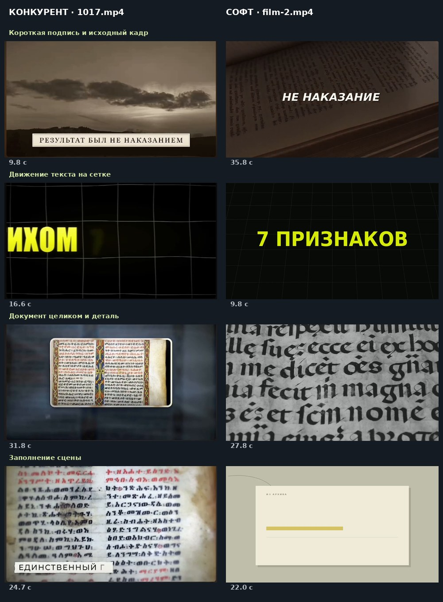

# Сравнение 1017.mp4 и film-2.mp4 — изменения v19

Проанализированы сами кадры обоих файлов. Оба файла полностью декодируются:
референс — 60,533 с, 1816 кадров, 854×480; результат Кадра — 49,267 с,
1478 кадров, 1280×720. Звук AAC stereo есть на всей длине обоих файлов.
У `film-2.mp4` нет прежней ошибки с коротким видеорядом. Таймкоды ниже относятся
к присланным файлам, а не к одному общему времени речи.



| Наблюдение | Конкурент | film-2 | Изменение в программе |
|---|---|---|---|
| Текст и исходный кадр | Около 9–12 с небольшая бумажная подпись «Результат был не наказанием» | Около 35–38 с отдельное «Не наказание» | Полная отрицательная фраза через границы cue; отдельный короткий нижний акцент |
| Сетка | Около 16–19 с движется крупная строка, сетка стоит | Около 9–11 с заголовок после въезда замирает | Настоящая бегущая строка; движущаяся часть кодируется все кадры, не замирает из-за кэша удержания |
| Крупность | Около 31–34 с документ целиком в рамке; рядом с этим есть детали страниц | Около 26–33 с сильно обрезанная рукопись | Раздельные общий план, документ и деталь; сохранение краёв страницы, мягкое укрупнение внутри плана |
| Пустой блок | Изображение остаётся под короткой надписью | Около 20–26 с пустая бумажная карточка | Восстановление материала, если он есть в проекте; иначе повторный подбор, а не успешный экспорт пустой сцены |
| Видеокадр в рамке | Рамка и мягкая подложка входят в композицию | Старинная книга в начале показана в тяжёлом тёмном оформлении | Рамка работает и для живого видео; источник разделяется до обрезки, передний план не замораживается |
| Материалы | Иллюстрации и документы привязаны к историческому рассказу | Видны черепахи, туристы, прогулка по лесу; в конце книга с сиренью и чашкой | Уточнена проверка исторического контекста по тексту и метаданным; неподходящие автоматические назначения перепроверяются |
| Переходы | Часто обычная склейка; засветка и укрупнение используются как акценты | Длинные похожие планы не образуют такого рисунка; v18 выбирал эффекты по циклу | Выбор по соседним планам, крупности и моменту текста; большая часть границ — склейки, редкие засветки и зумы |
| Звук | Текст и движение образуют акценты; смешанная дорожка содержит также речь и музыку | По готовой смешанной дорожке нельзя надёжно выделить каждый отдельный SFX | Единый план только для реальных появлений текста; камера и смена кадра сами не звучат |

## Как работает новая логика

При импорте озвучки/SRT/VTT режиссёр выбирает границы смысловых групп с учётом
конца предложения и паузы. Это не равномерная нарезка каждые две секунды.
Для существующего проекта обновление оформления сохраняет длительности,
исходные таймкоды, ID материалов, смещения видео, голос и музыку. Новую
нарезку можно получить действием «Пересобрать планы и смену кадров»; перед
этим сохраняется резервная копия прежнего монтажа.

Камера получает роль: общий план, документ, деталь или графика. На фотографиях
и видеоматериалах работают плавный наезд, отъезд и смещение. У детали есть
один плавный переход к большей крупности около акцента или середины длинного
смыслового блока. Часы камеры продолжаются до конца сцены и не сбрасываются
каждую секунду. У страницы в рамке перемещается весь прозрачный холст,
поэтому не отрезаются верх и низ листа. Для видео передний план остаётся живым.

Крупные вставки и небольшие подписи имеют разные бюджеты: до двух крупных
и до трёх коротких подписей в минуту. Это позволяет показать отрицание
и короткую важную фразу, не расходуя на них весь лимит больших экранов.
Тексты, даты и количества берутся из исходных субтитров. Год 2010 и чужие
счётчики из референса не добавляются в рассказ без соответствующего текста.

Добавлены красные цифры с рисующейся светлой петлёй и крупный светлый
перспективный заголовок. Варианты v18 сохранены, но отдельные переходы больше
не перебираются слепо по кругу. Звук не создаётся на склейке, зуме или
продолжении уже видимой надписи. До появления текста и после его анимации
в дорожке эффектов — нули; голос и музыка остаются отдельными дорожками.

## Проверки и практические границы

Полный итоговый набор: **165 тестов прошли**, без пропусков. Дополнительно
прошли проверки Chromium для миграции оформления и импорта озвучки/субтитров.

Проверены живое видео в рамке и боковой панели, красный верх и синий низ
страницы при движении, смена изображения внутри видеокарточки, неподвижная
сетка и движение текста после входа, перенос его часов через сцену,
сохранение исходного проекта, запрет пустых карточек и современные стоки
в историческом контексте. Эти проверки выполняют настоящий рендер FFmpeg.

`downloads/documentary-v19-demo.mp4` — полный технический пример на 49,267 с,
1478 кадров. Он создаётся автоматическим режиссёром из контрольных фраз и
собственной условной графики, включает живые видеоисточники. Проверены
полное декодирование, кадры после экспорта и звуковые окна. В его SFX-дорожке
вне окон появления текста максимальный RMS равен нулю с отступом 70 мс
для AAC. Это не пересборка пользовательского проекта.

Из готового MP4 нельзя восстановить исходные файлы, cue и раздельные голос,
музыку и эффекты. Для точной пересборки `film-2` используется исходный проект
Кадра и его материалы. Проверки материалов здесь основаны на описаниях,
не на автоматическом распознавании картинки. Совпадение авторских эффектов
конкурента один в один не заявляется. Сам macOS в этом прогоне недоступен;
проверены FFmpeg и Chromium на Linux, установщик Python 3.12 сохранён.

Повторить технический пример можно командой:

```bash
.venv/bin/python scripts/render_documentary_v19_demo.py
```

На Mac при наличии `.venv-py312` используйте её Python. JSON рядом с примером
содержит контрольные настройки и ffprobe; временные тестовые медиа в него
не упакованы. Это журнал проверки, а не переносимый пользовательский проект.
