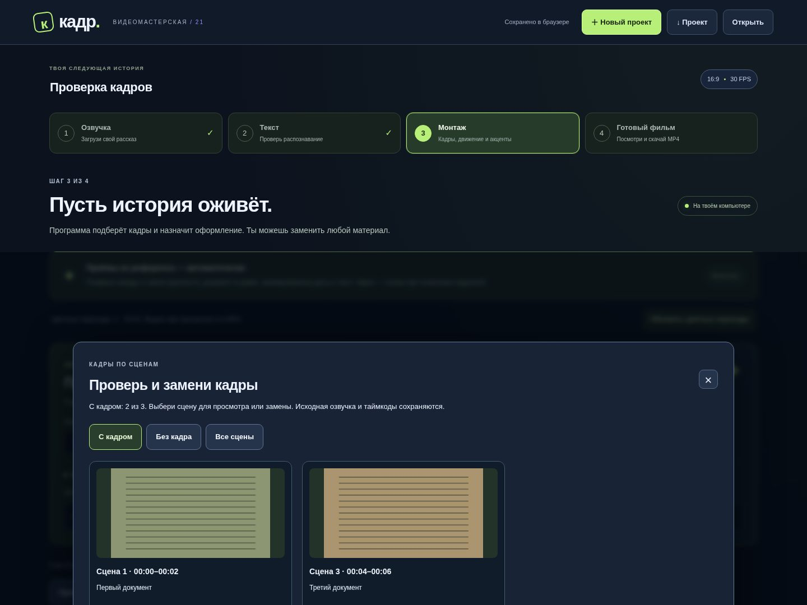
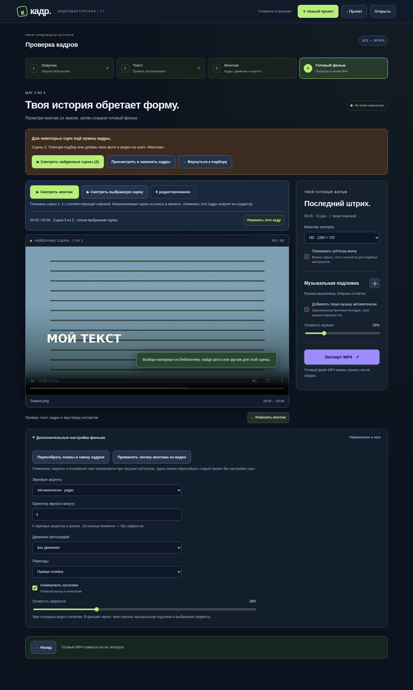
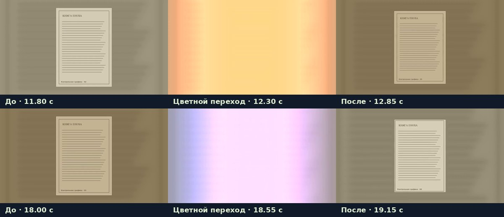

# Кадр v21 — проверить найденные кадры, продолжить поиск, увидеть переходы

## Если один источник ограничил загрузку

Раньше найденный результат мог остановить перебор поисковых фраз, даже если
сам файл затем не загрузился. Теперь программа отдельно проверяет успех
загрузки: перебирает кандидатов и подключённые источники, затем запускает
запасные запросы на доступных сервисах. Ограничение Wikimedia не выключает
поиск фото и видео через Pexels/Pixabay. Источник с ошибкой не опрашивается
заново для каждой сцены того же задания.

В отчёте указаны проверенные источники. **Pexels и Pixabay требуют API-ключи**;
их можно добавить через «Подключить Pexels / Pixabay» на шаге монтажа.
Если ключей нет, программа сообщает об этом, а не пишет, что стоки проверены.
Повторить поиск только для незаполненных сцен можно кнопкой
**«Найти недостающие кадры»**. Ручные назначения в остальных сценах сохраняются.
Подбор оценивает текст и описания, а не распознаёт содержимое картинки.

## Просмотр и замена

На шаге **3. Монтаж** нажми **«Просмотреть кадры»**. В галерее можно показать
готовые сцены, пропуски или все сцены. У каждой карточки — просмотр,
замена/добавление кадра и поиск другого варианта.

**«Смотреть найденные сцены»** запускает видео из уже заполненных сцен.
Например, если кадры есть для сцен 1 и 3, они идут подряд с озвучкой сцен
1 и 3; звук второй сцены туда не попадает. Субтитры временно пересчитываются
только для этого просмотра. Основной проект, исходные фразы, таймкоды,
назначения кадров и видео-смещения сохраняются. На экране остаются исходные
номера сцен, поэтому «Изменить этот кадр» открывает нужный редактор.

Такой просмотр можно восстановить после перезагрузки. Замена кадра требует
обновить просмотр; частичное и полное видео имеют разные записи в кэше.
Полный экспорт продолжает проверять весь проект: неполный просмотр не выдаётся
за готовый фильм. Для рукописей не подставляются случайные современные кадры.

## Цветные переходы

Прежнее правило выбирало засветку главным образом при смене типа плана.
Когда весь рассказ состоял из документов, такого перехода могло почти не быть.
Добавлен подбор цветных акцентов по времени, включая документальные планы:
тёплая засветка и сине-розовый перелив длительностью 0,6–0,7 с.
Появление крупного текста в начале следующей сцены имеет приоритет;
на повторе того же источника цветной эффект не навязывается.

Уже сохранённый проект получает эти переходы один раз, без изменения кадров,
озвучки, текстовых акцентов, камеры и длительностей. Есть кнопки повторного
применения и возврата прежних переходов. В интерфейсе показаны их моменты.
После обновления нужно **пересобрать просмотр или MP4**, чтобы увидеть изменения.

Это кадры из настоящего закодированного видео:

[Полный технический пример v21](../downloads/documentary-v21-demo.mp4)
длится **49,267 с / 1478 кадров**. В нём цветные переходы начинаются на
**12,0, 18,2 и 36,0 с**. [JSON с параметрами и звуковыми окнами](../downloads/documentary-v21-demo.json).
Контрольные документы и фразы созданы для проверки; это не пересобранный
пользовательский фильм. Чужой звук из референса не копировался.
Смена кадра и цветная засветка звукового эффекта не создают — звуки только
при появлении текста.

## Проверка

- Автоподбор: Wikimedia HTTP 429 → запасной запрос стокового видео;
  найденный, но нечитаемый файл → новая поисковая фраза;
  Pexels HTTP 429 при загрузке → Pixabay; честный отчёт без ключей.
- Настоящий частичный MP4: **4 с / 120 кадров** из сцен 1 и 3.
  В исходной контрольной озвучке у каждой сцены своя частота; анализ звука
  подтвердил третью сцену после пропуска второй. Исходный проект не изменился.
- Chromium с настоящими API и сборкой видео: фильтры галереи, просмотр одной
  сцены и найденных сцен подряд, правильный номер при редактировании,
  замена и заполнение выбранного кадра, перезагрузка, отдельный кэш полного
  фильма, **6 с / 180 кадров** после заполнения пропуска, узкий экран.
- Проверены полный четырёхшаговый сценарий, распознавание с подменённым
  результатом модели, редактирование SRT и обновление старого оформления.
- Цвет проверен по пикселям настоящего MP4; в отдельном ролике без текста
  звуковой дорожки переходов нет. Полный технический пример декодирован
  до конца и проверен по числу кадров.

Ответы стоков в тестах автоподбора подменены, чтобы воспроизвести HTTP 429
и ошибки файлов. Доступность реальных источников на компьютере пользователя
зависит от сети, ключей и ограничений сервисов.

## Обновление на Mac

1. [Скачай полный архив v21](../downloads/kadr-studio-v21.zip) и распакуй его.
2. Останови старый Кадр через **Control+C** в его Терминале.
3. Запусти из новой папки **«Обновить Кадр.command»** и выбери старую папку программы.
4. Обнови страницу: в шапке должна быть версия **/ 21**.
5. На шаге монтажа можно сразу открыть найденные кадры. Чтобы увидеть новые
   переходы, заново подготовь просмотр или экспорт.

Для новой установки используй **«Запустить Кадр.command»**. Поддержка отдельной
среды Python 3.12 на Mac с системным Python 3.14 сохранена. Материалы и
локальные ключи при обновлении не удаляются.
