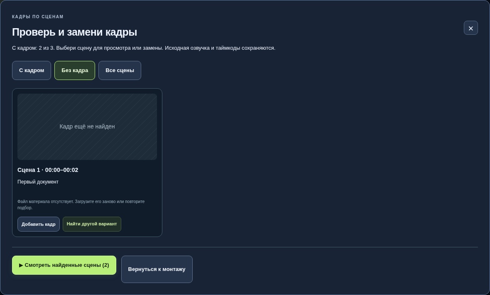

# Кадр v22 — счётчик готовности соответствует просмотру

## Причина ошибки

Интерфейс v21 считал наличие `asset_id` готовым кадром. При полном просмотре
и экспорте `complete_visuals` дополнительно перепроверял автоматические
назначения и разрешал использовать каждый материал только два раза за фильм.
Повторный подбор, напротив, пропускал любое назначение с заполненным ID.
Поэтому «все сцены заполнены» могло сочетаться с отказом сборки на 0%.

Присланный проект содержит 235 сцен, 46 разных материалов, 696 cue и
45 803 кадра / 25:26,767. Соседних повторов нет. При воспроизведении с
контрольными метаданными старый код отказал на сцене 66, новый сохранил
проект целиком без изменений. Это воспроизведение логики, а не проверка
пользовательских изображений: JSON не включает исходные медиа и их описания.

## Изменения

- Поздний повтор подходящего сохранённого кадра разрешён. Двукратный бюджет
  остаётся при поиске запасных назначений; соседние автоматические повторы
  и проверка темы по описанию сохраняются.
- `/api/project/readiness` выполняет общую проверку для счётчика, галереи,
  повторного подбора, полного/частичного просмотра и экспорта. Проверяются
  наличие и чтение файлов, нужные дорожки, видео-смещение и метаданные
  автоматических назначений. Изображения проверяются Pillow, видео и звук —
  ffprobe; результаты файловой проверки кэшируются по пути, размеру и времени
  изменения файла. Это не визуальное распознавание содержимого кадра.
- До ответа сервера интерфейс пишет «Проверяем файлы и назначения сцен».
  Кнопка «Проверить материалы» принудительно обновляет результат, в том числе
  после удаления файла вне браузера. Перед сборкой выполняется новая проверка.
- В галерее «Без кадра» указаны причины отказа. Повторный подбор исправляет
  также негодное назначение с уже существующим ID, сохраняя остальные сцены.
  Нечитаемые файлы не возвращаются в подбор из локальной библиотеки.
- Проект с потерянными файлами можно открыть для исправления. Полная сборка
  останавливается до постановки задания в очередь с конкретными номерами
  сцен; отчёт больше не заменяет их общей фразой.
- Кэш браузера и просмотра обновлён. Основной монтаж, исходные cue, голос,
  переходы и эффекты не переназначаются этим обновлением.

## Проверка

- **190 тестов unittest проходят**, включая 9 новых: длинный сохранённый
  монтаж, соседние повторы, потерянный/пустой/повреждённый файл, неверное
  описание, недоступная озвучка, отказ до очереди и исправление назначения.
- Реальные полный просмотр 540p и экспорт 720p семи сцен с чередованием двух
  материалов: **210 кадров / 7 секунд**, звуковая дорожка той же длительности.
  Один материал используется четыре раза. Проверена ветка без libass.
- Реальный Chromium: галерея и фильтры, единичный и частичный просмотр с
  правильными отрезками голоса, замена конкретного кадра, восстановление
  после перезагрузки, полный MP4 из 180 кадров, мобильный экран. После удаления
  файла счётчик меняется с 3/3 на 2/3 и полный просмотр не попадает в очередь.
- На исходном JSON с контрольными файлами проверены все 235 назначений и
  сохранность всех полей проекта. Контрольные файлы не содержат пользовательской
  озвучки или изображений. Этот JSON в публичный репозиторий не включён.

Среда проверки: Linux, CPython 3.12, FFmpeg 7.1.5, Chromium 154. FFmpeg 9.0.2
и запуск на Mac в этой среде не проверялись. Полный 25-минутный фильм с
исходными медиа пользователя не пересобирался: этих файлов нет в JSON.
Сетевые стоки и качество распознавания речи этим обновлением не оценивались.

## Обновление на Mac

1. Остановите старый сервер сочетанием Control+C в его Терминале.
2. Распакуйте `kadr-studio-v22.zip` и запустите «Обновить Кадр.command».
3. Выберите старую папку программы: обновление сохранит `.data` с файлами
   и ключами, а изменяемый код скопирует с резервной копией.
4. Откройте прежний JSON, нажмите «Проверить материалы». Если есть проблемы,
   откройте «Просмотреть кадры» → «Без кадра» и запустите подбор недостающих.
5. Пересоберите просмотр. Старый экспорт MP4 автоматически не изменяется.
