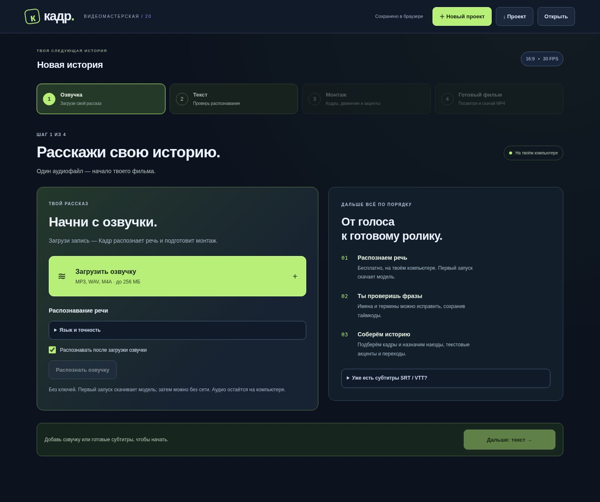
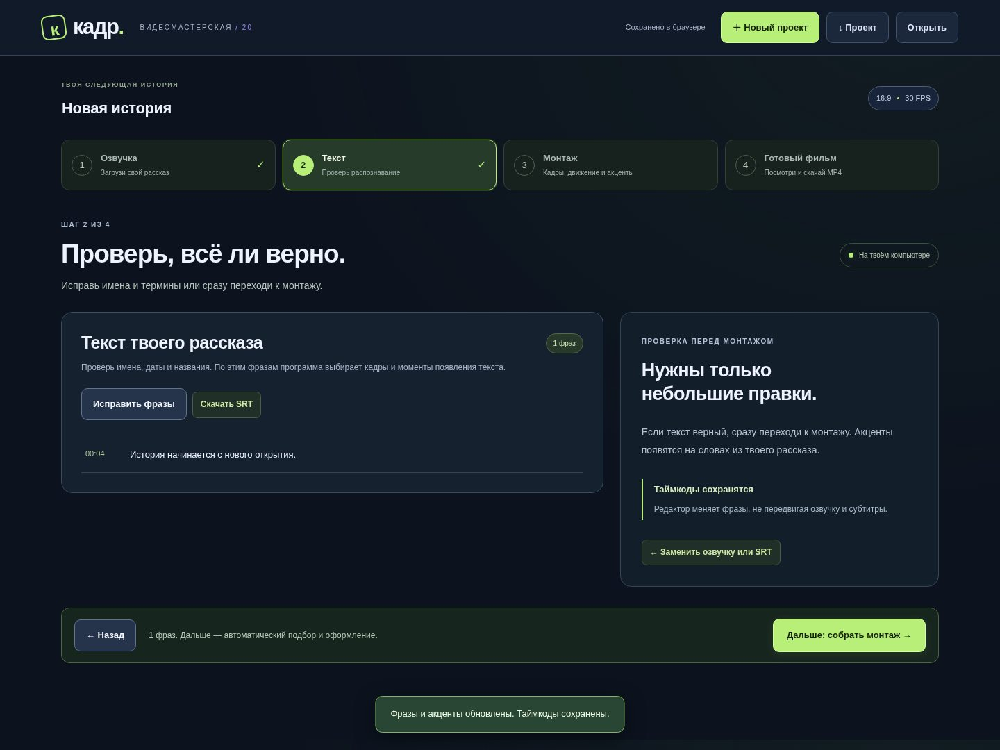
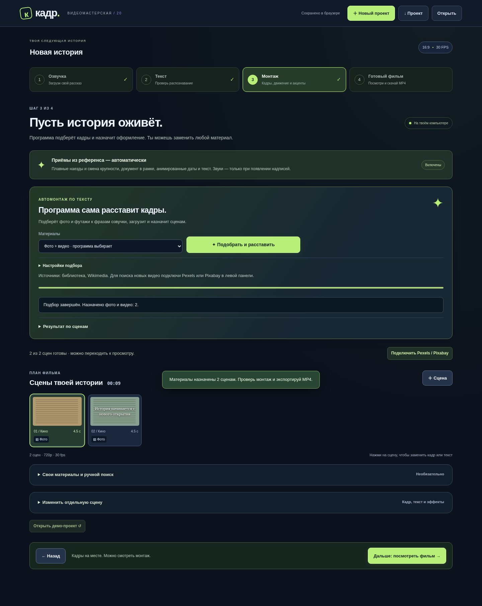
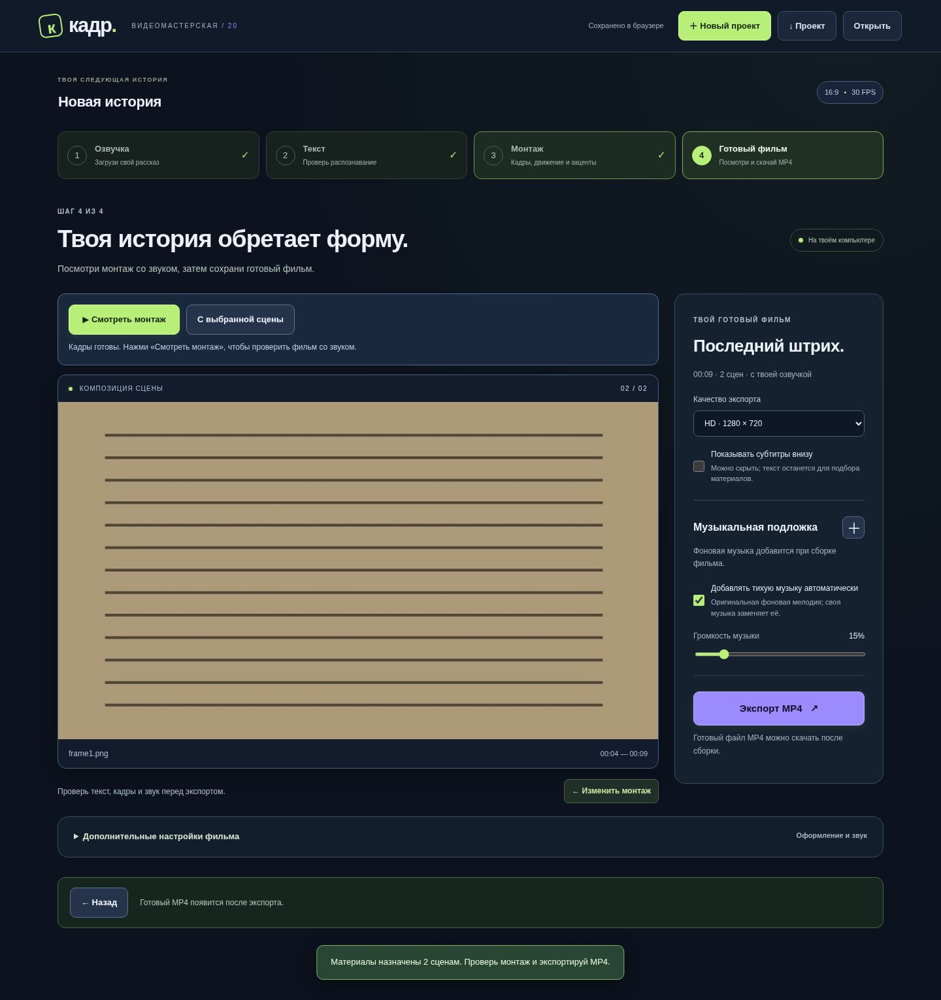

# Кадр v20 — от озвучки к готовому фильму

Вместо трёх одновременно открытых колонок — четыре последовательных экрана.
Назначение приёмов из 1018.mp4 остаётся автоматическим. Этот файл совпадает
с присланным ранее референсом; новые чужие звуки или кадры в программу не копировались.

## 1. Озвучка

Загрузи аудио. Распознавание стартует автоматически. Язык и точность спрятаны
под отдельным раскрывающимся пунктом; остановка и состояние задания доступны
сразу. Готовые SRT / VTT можно загрузить через «Уже есть субтитры».

## 2. Текст

После распознавания или загрузки SRT открывается текст рассказа.
«Исправить фразы» меняет слова, сохраняя таймкоды. «Дальше: собрать монтаж»
переходит к материалам. На этом этапе сетевой подбор ещё не начинается.

## 3. Монтаж

При переходе программа сама начинает подбор. Здесь находятся выбор фото/видео,
состояние задания, результаты по сценам, свои материалы и подключение источников.
Подробный редактор спрятан; он открывается при нажатии на сцену.
Найденные кадры не теряются после обновления страницы. Неудачный поиск
не запускается снова при каждом обновлении: его можно повторить кнопкой.

Монтаж сочетает общий план, документ и деталь, плавный наезд и укрупнение,
короткие подписи, крупные акценты, бегущую строку, обводки цифр и редкие
световые переходы. Текст берётся из рассказа; даты и статистика не выдумываются.
Синтезированные звуки выбираются по типу появления. На смене кадра, зуме
без новой надписи и продолжении текста нового звука нет.

## 4. Готовый фильм

«Смотреть монтаж» готовит видео со звуком. Здесь же находятся музыка,
показ нижних субтитров, качество и экспорт. Если кадры отсутствуют, программа
показывает номера сцен и возвращает к подбору при попытке сборки.
Возврат к тексту и обратно сам по себе не пересобирает готовый просмотр.

## Исправление ошибки на скриншоте

Ошибка воспроизведена на фразе с началом `4,490 с` при границе сцен `4,500 с`.
Прежний режиссёр создавал в первой сцене акцент на 10 миллисекунд, хотя для него
не оставалось ни одного кадра; проверка заголовка останавливала всё распознавание.

Теперь визуальные события сначала переводятся на общую сетку 30 кадров/с,
затем разделяются между сценами. Невидимый остаток не создаёт заголовок.
Продолжение сохраняет фазу анимации и не повторяет звук. Исходные фразы и
таймкоды не округляются. Исправлена также допустимость появления в последней
секунде 30-секундной сцены. При других ошибках проверки распознавание показывает
короткое русское сообщение без дампа проекта и ссылок Pydantic.

## Обновление на Mac

1. Скачай [полный архив v20](../downloads/kadr-studio-v20.zip) и распакуй его.
2. Останови работающий Кадр сочетанием **Control+C** в его Терминале.
3. Из новой папки запусти **«Обновить Кадр.command»** и выбери старую папку Кадра.
   Установщик сохраняет материалы и ключи; код перед заменой резервируется.
4. Обнови страницу браузера. В шапке должна быть версия **/ 20** и четыре шага.
   Восстановленный монтаж остаётся доступен; для новой озвучки нажми «Новый проект».

Для установки с нуля используй **«Запустить Кадр.command»** из распакованной
папки. Исправление для Mac с Python 3.14 сохранено: рабочая среда использует
совместимый CPython 3.12, не меняя системный Python.

## Проверка

- **171 Python-тест**, включая распознавание у границы кадра, продолжение
  акцента, старый проект с дробной длительностью и появление на последней секунде.
- Chromium: все четыре шага, распознавание с восстановлением задания,
  проверка текста без преждевременного поиска, отложенный подбор, восстановление
  поиска без дубликатов, редактор сцены, сохранение таймкодов и просмотр.
- Настоящие просмотр и экспорт в браузере: **9 с / 270 кадров**, звуковая дорожка,
  полное декодирование. Ручной SRT, отключённый автоподбор, недостающие кадры,
  открытие замены и ключей, новый проект и узкий экран.
- Отдельно проверены отмена распознавания, поздний результат для старого проекта,
  исправление фраз через настоящее API, SRT с миллисекундами и обновление
  оформления старого проекта с возможностью возврата.
- [Полный технический пример v20](../downloads/documentary-v20-demo.mp4):
  **49,267 с / 1478 кадров**, контрольные документы и фразы. Это проверка приёмов,
  а не пересобранный фильм пользователя. Рецепт и звуковые окна находятся
  [рядом в JSON](../downloads/documentary-v20-demo.json).
- В закодированной аудиодорожке технического примера вне окон появления
  (с допуском 70 мс для AAC) среднеквадратичная амплитуда равна нулю.

Модель распознавания и внешние стоковые ответы в браузерной проверке подменены
контрольными результатами. Реальное качество распознавания на твоём Mac и
доступность источников эта проверка не устанавливает. Подбор оценивает текст
и описания материалов, а не распознаёт содержимое каждого изображения.
